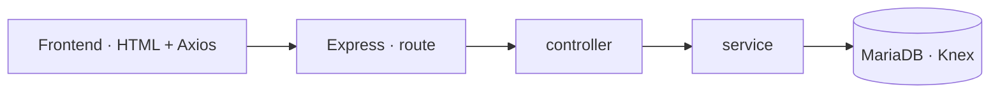

# Backline

Aplicación para que los empleados de una empresa de alquiler de guitarras gestionen el **inventario** y los **alquileres**. Backend en **Node.js con Express**, base de datos **MariaDB** y frontend web con **Axios**, todo contenerizado con **Docker** y con integración continua en **GitHub Actions**.

---

## Funcionalidades

- **Inventario de guitarras:** listar, ver, añadir, editar y eliminar.
- **Alquileres:** desde cada guitarra, el botón **RENT** abre los alquileres activos y un formulario con el id de la guitarra ya rellenado.
- **Duración del alquiler** calculada al consultar uno concreto.
- **Validación y errores HTTP claros:** `400` si faltan datos o la fecha de devolución no es válida, `404` si el recurso no existe, `201` al crear. Si se intenta alquilar una guitarra que no existe, la clave foránea lo impide y la API devuelve un error.

---

## Arquitectura



- **route:** define los endpoints.
- **controller:** valida la petición y decide el código de respuesta.
- **service:** accede a la base de datos con Knex.

---

## Endpoints

| Método | Ruta | Descripción |
|---|---|---|
| GET | `/guitars` | Lista de guitarras |
| GET | `/guitars/:guitarId` | Detalle de una guitarra |
| POST | `/guitars` | Alta de una guitarra |
| PUT | `/guitars/:guitarId` | Modificación |
| DELETE | `/guitars/:guitarId` | Baja |
| GET | `/rentals` | Lista de alquileres |
| GET | `/rentals/:rentalId` | Detalle del alquiler, con su duración |
| POST | `/rentals` | Nuevo alquiler |
| PUT | `/rentals/:rentalId` | Modificación (guitarra y fecha de devolución) |
| DELETE | `/rentals/:rentalId` | Eliminación |

---

## Configuración por entornos

La API lee su configuración (base de datos y puerto) de un archivo YAML que se elige al arrancar con `--config`:

- `config.local.yaml`: desarrollo local.
- `config.prod.yaml`: imagen Docker.

---

## Tests

| Tipo | Herramientas | Qué cubre |
|---|---|---|
| Unitarios | Jest | Lógica de guitarras, alquileres y utilidades (validaciones, cálculo de fechas) |
| Integración | Mocha, Chai, chai-http, Sinon | Los endpoints de guitarras y alquileres contra una base de datos real |

```bash
npm run unit-test          # Jest
npm run integration-test   # Mocha
npm test                   # todos
```

---

## Integración continua

Dos workflows de **GitHub Actions** en cada *push* o *pull request* a `main`:

- **Backline CI:** levanta MariaDB con Docker Compose y ejecuta los tests unitarios y de integración en **Node 18, 20 y 22** (matriz de versiones).
- **Docker Image CI:** comprueba que la imagen Docker se construye correctamente.

---

## Ejecución en local

Requisitos: Node.js y Docker.

```bash
# 1. Base de datos (crea las tablas y datos de ejemplo de db/script.sql)
make start-dev-env

# 2. Backend (puerto 8080)
npm install
npm start

# 3. Frontend (puerto 1234), en otra terminal
cd frontend
npm install
npm start
```

Abre http://localhost:1234.

Para lanzar los tests sobre un entorno limpio:

```bash
make all-test
```

---

## Stack

Node.js · Express · Knex · MariaDB · Axios · Parcel · Jest · Mocha · Chai · Sinon · Docker · Docker Compose · GitHub Actions · Make

---

## Mejoras previstas

- Leer las credenciales de la base de datos desde variables de entorno en lugar de los archivos YAML.
- Publicar la imagen en un registro y completar el despliegue de los tres servicios con Docker Compose.

---

**Autor:** Aritz Ontalvilla
